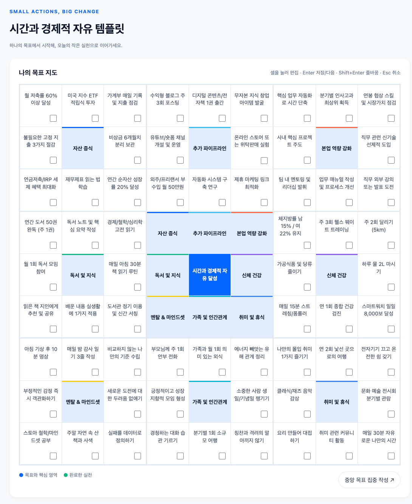

# 만다라트 플래너 (Mandalart Planner)

> **서버·회원가입·빌드 없이** 브라우저에서 바로 열어 사용하는 독립 완결형 9×9 만다라트 목표 달성 플래너



---

## 📌 프로젝트 소개

만다라트 플래너는 1개의 핵심 목표를 중심으로 8개의 세부 목표와 64개의 실행 과제를 체계적으로 수립하고 진행 상황을 추적할 수 있는 웹 애플리케이션입니다.  
외부 라이브러리나 런타임 빌드 도구 없이 **순수 표준 웹 기술(HTML5, Vanilla CSS, Vanilla JavaScript)**만으로 구현되어 있으며, 배포 파일(`mandalart.html` 또는 `index.html`) 단 하나만으로 어디서나 완벽하게 작동합니다.

---

## ✨ 핵심 기능

1. **81칸 정밀 그리드 & 양방향 동기화**:
   - 중앙 3×3 블록의 8개 세부 목표와 외곽 8개 블록의 중심 목표가 실시간으로 양방향 자동 동기화됩니다.
2. **3×3 집중 편집 모드**:
   - 전체 81칸 조망뿐 아니라, 특정 영역에만 몰입할 수 있는 3×3 세부 집중 모달을 제공합니다.
3. **진척도 실시간 계산 및 시각화**:
   - 64개 실행 과제의 체크박스를 통해 전체 및 영역별 달성률을 실시간으로 추적합니다.
4. **엄선된 3종 프리셋 템플릿**:
   - 오타니 쇼헤이 만다라트 (야구/목표 달성)
   - 개발자 커리어 성장 만다라트
   - 웰니스 & 라이프 밸런스 만다라트
5. **데이터 보존 & 백업 (무서버/로컬 우선)**:
   - **LocalStorage 자동 저장**: 새로고침이나 브라우저 재시작 시에도 데이터가 즉시 복원됩니다.
   - **JSON 백업/복원**: 작성한 만다라트를 JSON 파일로 내보내거나 불러올 수 있습니다.
6. **고해상도 PNG 이미지 저장**:
   - Canvas API 기반으로 전체 81칸과 테마가 반영된 완성형 이미지를 원클릭으로 다운로드할 수 있습니다.
7. **다크 모드 & 라이트 모드**:
   - 시스템 설정 연동 및 수동 테마 전환 토글 지원 (WCAG 접근성 대비 규격 준수).
8. **반응형 설계 (모바일·태블릿·데스크톱)**:
   - 데스크톱(81칸 전체 뷰)부터 모바일(3×3 집중 뷰 우선)까지 뷰포트에 맞춘 최적화 레이아웃 제공.

---

## 🚀 빠른 시작

### 1. 즉시 실행 (가장 간단한 방법)
별도의 설치 없이 [mandalart.html](./mandalart.html) 파일을 웹 브라우저(Chrome, Safari, Edge 등)로 직접 드래그 앤 드롭하거나 더블 클릭하여 실행합니다.

### 2. 로컬 웹 서버로 실행 (선택 사항)
```bash
# 저장소 복제
git clone https://github.com/greeme99/CT-Mandalart.git
cd CT-Mandalart

# npx serve 또는 python 등을 사용해 실행
npx serve .
# 또는
python3 -m http.server 8080
```
브라우저에서 `http://localhost:8080` (또는 지정된 포트)로 접속합니다.

---

## 🧪 테스트 및 품질 검증

Node.js 내장 테스트 러너(`node:test`)를 사용하여 주요 로직, 데이터 무결성, 반응형 규격, 접근성 토큰을 검증합니다.

```bash
# 전체 테스트 실행 (19개 스펙)
npm test

# 디자인 토큰 검사
npm run design:lint
```

### 테스트 커버리지 항목
- `mandalart.html` 배포 산출물 바이트 무결성
- 8방향 중심-외곽 데이터 바인딩 동기화
- 프리셋 데이터 및 64개 실행 과제 구조 검증
- 입력 유효성 검사 및 XSS 방지 특수문자 정제
- LocalStorage 저장·복원 안정성
- Canvas 기반 PNG 직렬화
- 반응형 뷰포트 계약 및 터치 타깃 규격 (44px 이상)

---

## 🛠 기술 스택

- **Core**: HTML5, Vanilla JavaScript (ES2022+), Vanilla CSS
- **Storage & APIs**: Web Storage API (LocalStorage), File API, Canvas API
- **Testing**: Node.js `node:test` (Zero-dependency)
- **Architecture**: Single-file Self-contained Architecture

---

## 📄 라이선스

이 프로젝트는 MIT 라이선스에 따라 자유롭게 사용 및 수정이 가능합니다.
