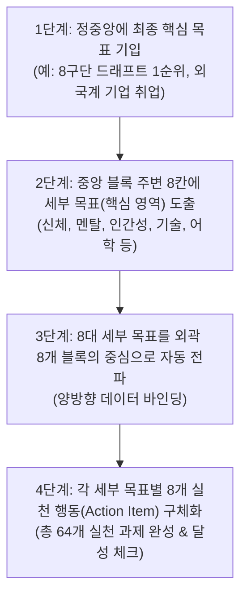
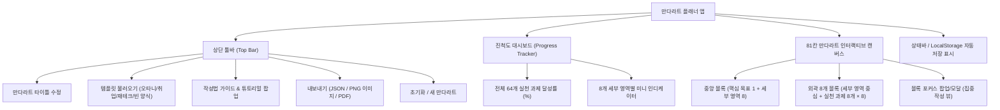

# 만다라트 작성 앱 (단독 실행 HTML / 모던 웹) 개발 기획안 (PRD)

본 문서는 **"만다라트 작성 앱 (Mandalart Planner)"**의 프론트엔드 및 데이터 구조 구현을 위한 공식 제품 개발 기획안(PRD 및 기능 명세서)입니다.  
크롤링 및 정리된 [`만다라트-작성법.md`](file:///Users/greeme/Downloads/Workspace/Mandarat/만다라트-작성법.md)의 원칙과 [`mandalart-presets.json`](file:///Users/greeme/Downloads/Workspace/Mandarat/mandalart-presets.json) 템플릿 규격을 기반으로 실제 구현 가능한 명세를 정의합니다.

---

## 1. 개요 및 제품 비전

### 1.1 제품 목표
- **단일 허브 목표 관리**: 81칸(9×9) 만다라트 매트릭스를 브라우저 상에서 즉각 작성하고, 중앙-외곽 블록 간 양방향 실시간 동기화를 지원합니다.
- **최소 클릭, 최대 효율**: 별도의 복잡한 회원가입이나 백엔드 서버 없이도 브라우저 단독(단일 HTML 파일 또는 모던 SPA)으로 완벽하게 동작합니다.
- **실천 중심 UX**: 막연한 목표 수립에 그치지 않고 64개 세부 실천 과제별 달성 상태(O/X 체크) 및 실시간 진척도(Progress Bar)를 시각화합니다.

### 1.2 핵심 타겟 및 페인 포인트
| 구분 | 내용 |
| :--- | :--- |
| **타겟 사용자** | 신년 목표를 세우는 개인, 취업/이직 준비생, 자격증/시험 준비생, 자기계발 및 커리어 로드맵 구축자 |
| **기존 페인 포인트** | 1. 종이/엑셀로 작성 시 중앙 목표와 외곽 8개 영역 간 수기 복사 번거로움<br>2. 81칸을 한눈에 보면서도 특정 세부 영역에 집중하기 어려운 화면 가독성<br>3. 작성 후 일상에서 실천 여부를 지속적으로 체크하기 어려움 |
| **해결 방안** | 1. **양방향 실시간 동기화**: 중앙 8개 세부 목표 입력 시 외곽 8개 블록의 중심 칸으로 자동 전파<br>2. **줌/포커스 모드**: 전체 81칸 뷰 및 개별 3×3 블록 집중 뷰 전환 지원<br>3. **템플릿 프리셋 탑재**: 오타니 쇼헤이형, 글로벌 기업 취업형, 경제적 자유형 템플릿 1초 적용 |

---

## 2. 만다라트 작성 원리 및 온보딩 체계

[`만다라트-작성법.md`](file:///Users/greeme/Downloads/Workspace/Mandarat/만다라트-작성법.md)에 기술된 공식 4단계 가이드라인을 앱 내 인터랙티브 튜토리얼로 제공합니다.



---

## 3. 정보 구조도 (IA) & 사용자 플로우

### 3.1 정보 구조도 (Information Architecture)


### 3.2 사용자 플로우 (User Flow)
1. **첫 방문**: 온보딩 팝업 노출 → "작성법 보기" 또는 "샘플 템플릿(오타니 쇼헤이 / 취업 준비)으로 시작하기" 선택
2. **작성 단계**:
   - 중앙 블록 중심에 최종 핵심 목표 입력
   - 주변 8칸에 세부 목표 입력 (실시간으로 외곽 8개 블록 중심에 반영)
   - 외곽 블록을 클릭하여 세부 실천 행동(8개씩) 작성
3. **실천 및 관리**: 매일 실천 과제 체크박스를 눌러 완료 여부 체크 → 상단 달성률 게이지 상승
4. **저장/공유**: 브라우저 LocalStorage에 자동 저장, 완료된 만다라트는 고화질 PNG 이미지로 저장하여 스마트폰 배경화면/출력물로 활용

---

## 4. 상세 기능 명세서 (Functional Specification)

### 4.1 81칸 인터랙티브 매트릭스 그리드
| 요구사항 ID | 기능명 | 기능 상세 설명 | 수용 기준 (Acceptance Criteria) |
| :--- | :--- | :--- | :--- |
| **REQ-1.1** | **9×9 매트릭스 렌더링** | 3×3 블록 9개로 이루어진 81칸 반응형 그리드 UI 제공 | - 데스크톱 및 태블릿 화면에서 왜곡 없이 정사각형 그리드 유지.<br>- 중앙 블록과 외곽 8개 블록 간 시각적 경계선 및 색상 테마 차별화. |
| **REQ-1.2** | **양방향 실시간 동기화** | 중앙 블록의 8개 세부 목표 칸과 외곽 8개 블록의 중심 칸 실시간 연동 | - 중앙 블록의 세부 목표 수정 시 해당 외곽 블록의 중심 텍스트 즉시 변경.<br>- 반대로 외곽 블록의 중심 칸 수정 시 중앙 블록의 해당 칸도 즉시 동기화. |
| **REQ-1.3** | **인라인 편집 (Inline Edit)** | 셀 더블클릭 또는 클릭 시 즉시 텍스트 입력 모드로 전환 | - Enter 키 입력 시 저장 및 다음 셀 포커스 이동 지원.<br>- ESC 키 입력 시 직전 값으로 복원. |
| **REQ-1.4** | **포커스 줌 모드** | 특정 3×3 블록을 클릭하면 확대 모달/카드 형태로 집중 작성 지원 | - 81칸 전체 화면이 작은 화면(모바일/작은 태블릿)에서도 손쉽게 9칸 단위로 작성 가능. |

### 4.2 템플릿 프리셋 시스템 (`mandalart-presets.json` 연동)
| 요구사항 ID | 기능명 | 기능 상세 설명 | 수용 기준 (Acceptance Criteria) |
| :--- | :--- | :--- | :--- |
| **REQ-2.1** | **프리셋 템플릿 로더** | 내장된 검증 템플릿 3종 즉시 불러오기 | - 1. **오타니 쇼헤이형** (8구단 드래프트 1순위)<br>- 2. **글로벌 기업 취업형** (외국계 기업 취업 로드맵)<br>- 3. **경제적 자유형** (시간 및 자산 성장)<br>- 기존 작성 데이터가 있을 경우 덮어쓰기 전 확인(Confirm) 다이얼로그 노출. |
| **REQ-2.2** | **빈 양식 시작 (Reset)** | 81칸 전체를 깨끗한 백지 상태로 초기화 | - 초기화 완료 후 중앙 목표 셀에 자동 포커스. |

### 4.3 실천 관리 및 달성률 트래커 (Action Tracking)
| 요구사항 ID | 기능명 | 기능 상세 설명 | 수용 기준 (Acceptance Criteria) |
| :--- | :--- | :--- | :--- |
| **REQ-3.1** | **실천 과제 O/X 체크** | 외곽 64개 실천 행동 셀에 체크박스 토글 지원 | - 체크 시 취소선 및 완료 색상(반투명/초록 계열) 스타일 적용.<br>- 텍스트 편집 모드와 체크 토글 모드가 충돌하지 않도록 명확한 UI 분리. |
| **REQ-3.2** | **실시간 달성률 게이지** | 전체 및 영역별 달성 현황 대시보드 표시 | - 전체 진척도: `(완료된 실천과제 수 / 64) * 100%`<br>- 8개 영역별 미니 달성률 바(0/8 ~ 8/8) 노출. |

### 4.4 가이드 & 온보딩 모달
| 요구사항 ID | 기능명 | 기능 상세 설명 | 수용 기준 (Acceptance Criteria) |
| :--- | :--- | :--- | :--- |
| **REQ-4.1** | **작성법 안내 팝업** | [`만다라트-작성법.md`](file:///Users/greeme/Downloads/Workspace/Mandarat/만다라트-작성법.md) 내용 기반 가이드 팝업 | - 만다라트 어원 및 4단계 작성법 요약 탭.<br>- 오타니 쇼헤이 실천 사례(인간성, 운, 멘탈 등) 인사이트 탭 제공. |

### 4.5 저장, 백업 및 이미지 내보내기
| 요구사항 ID | 기능명 | 기능 상세 설명 | 수용 기준 (Acceptance Criteria) |
| :--- | :--- | :--- | :--- |
| **REQ-5.1** | **LocalStorage 자동 저장** | 타이핑 즉시 브라우저 로컬 저장소에 영구 보관 | - 새로고침 또는 재접속 시 마지막 작업 상태 100% 복원.<br>- 우측 상단 "자동 저장됨" 인디케이터 제공. |
| **REQ-5.2** | **JSON 내보내기/가져오기** | 작성한 만다라트를 JSON 파일로 백업 및 복원 | - `mandalart-presets.json` 규격과 100% 호환되는 JSON 파일 다운로드 및 업로드 기능. |
| **REQ-5.3** | **고화질 이미지(PNG) 저장** | 81칸 전체 캔버스를 이미지 파일로 변환 다운로드 | - `html2canvas` 등을 활용해 폰트 깨짐 없는 고해상도(2x Retina) PNG 파일 생성.<br>- 스마트폰 배경화면용 또는 출력용 규격 대응. |

---

## 5. 데이터 스키마 표준 규격

[`mandalart-presets.json`](file:///Users/greeme/Downloads/Workspace/Mandarat/mandalart-presets.json)과 호환되는 표준 데이터 모델 구조입니다.

```typescript
export interface MandalartAction {
  id: string;              // 실천과제 식별자 (0 ~ 7)
  text: string;            // 실천과제 내용 (예: "토익 950점 취득")
  completed: boolean;      // 달성 여부 (true/false)
}

export interface MandalartSubGoal {
  index: number;           // 0 ~ 7 (중앙 블록 주변 8방향 위치)
  title: string;           // 세부 목표명 (예: "어학 역량")
  color: string;           // 테마 컬러 (HEX 코드)
  actions: MandalartAction[]; // 8개의 구체적 실천 과제
}

export interface MandalartData {
  id: string;              // 고유 ID
  title: string;           // 만다라트 프로젝트 제목
  coreGoal: string;        // 중앙 최종 핵심 목표 (1칸)
  subGoals: MandalartSubGoal[]; // 8대 세부 목표 및 각 8개 액션 (총 64개)
  createdAt: string;       // 생성 일시 (ISO String)
  updatedAt: string;       // 최종 수정 일시 (ISO String)
}
```

---

## 6. 화면 설계 및 UI/UX 가이드

- **디자인 룩앤필**: 
  - 세련된 다크/라이트 테마 지원 (Deep Navy/Slate Charcoal 베이스 다크 테마 권장)
  - 은은한 글래스모피즘(Glassmorphism)과 미세한 경계선 글로우(Glow) 효과
  - 모던 타이포그래피: **Pretendard Variable** / Inter 폰트 적용
- **그리드 레이아웃**:
  - `9 x 9` 전체 그리드 (3x3 대형 블록 9개)
  - 중앙의 3x3 대형 블록은 강조 색상(골드/인디고 그라데이션)으로 시각적 앵커 역할 수행
  - 각 대형 블록의 중심 셀은 볼드 텍스트 및 카테고리 컬러 뱃지 적용
- **반응형 대응**:
  - 데스크톱: 전체 81칸 일람 뷰 제공
  - 모바일/태블릿: 핀치 줌 또는 블록 클릭 시 단일 3×3 블록 편집 뷰 자동 전환

---

## 7. 검증 및 테스트 매트릭스

| 대상 | 필수 테스트 시나리오 | 검증 방법 |
| :--- | :--- | :--- |
| **양방향 동기화** | 중앙 블록의 세부 목표 수정 시 외곽 블록 중심 셀에 실시간 반영 여부 | 텍스트 입력 이벤트 및 상태 변경 검증 |
| **템플릿 프리셋** | 오타니 쇼헤이 / 취업 준비형 프리셋 로드 시 81칸 데이터 정확 누락 없이 렌더링 | 프리셋 로드 후 64개 액션 및 핵심 목표 데이터 무결성 검증 |
| **달성률 계산** | 실천 과제 체크박스 클릭 시 전체 게이지 및 해당 영역 퍼센티지 정확 연산 | O/X 체크박스 조작 시 진척도 수치 일치 테스트 |
| **데이터 보존** | 브라우저 새로고침 및 창 닫은 후 재접속 시 LocalStorage 데이터 복원 | 브라우저 리로드 후 이전 입력값 보존 확인 |
| **이미지 내보내기** | 전체 81칸을 PNG로 저장 시 글자 잘림이나 깨짐 없이 고화질 렌더링 | 생성된 PNG 파일 다운로드 및 시각 검증 |
